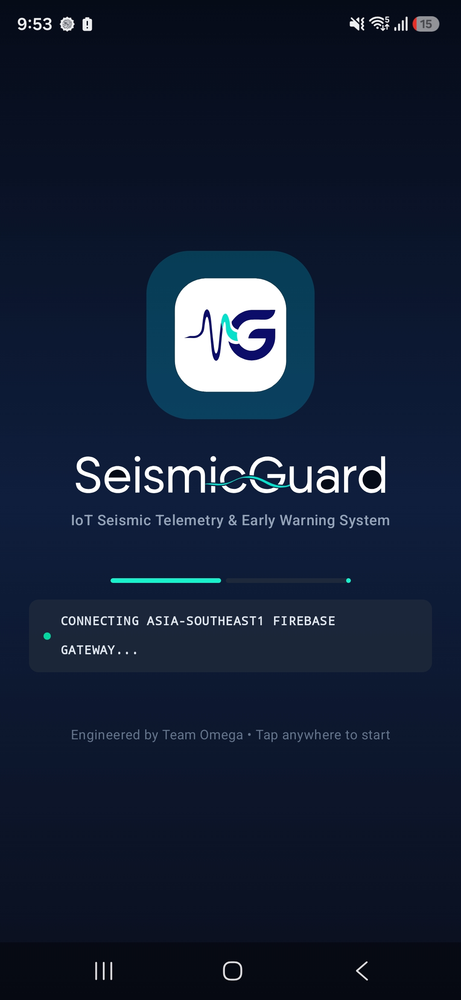
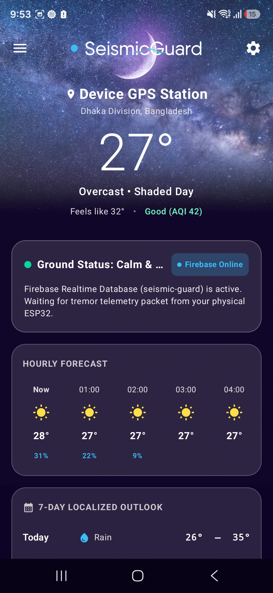
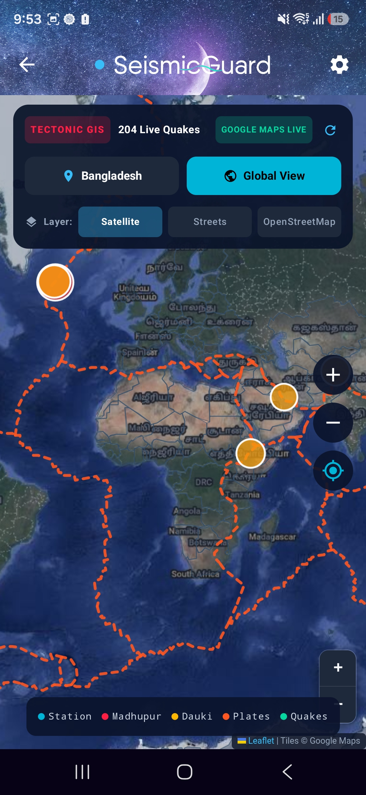
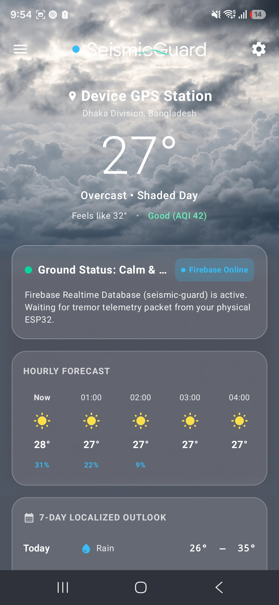

# SeismicGuard Omega

[](https://developer.android.com/)
[](https://kotlinlang.org/)
[](https://developer.android.com/about/versions)
[](https://github.com/rabayakhanam82-a11y/SeismicGuard)

SeismicGuard is a student-built seismic and vibration monitoring project that pairs an ESP32 sensor-and-siren unit with an Android companion app. The hardware detects repeated vibration pulses and sends status and alert events to Firebase Realtime Database; the app presents the incoming information and can show a prominent emergency alert.

This is an educational prototype, not a certified earthquake-warning or life-safety system. It detects local vibration; it does not predict earthquakes. Do not rely on it as a substitute for official alerts or safety procedures.

**Benchmark International School (BIS) Capstone Science Exhibition 2026**  
**Academic section:** Class 7 English Version (EV)  
**Project lead and app/code:** Abdullah Karim  
**Hardware team:** Abdullah, Mahir, Behan  
**Presentation:** Abdullah, Ahmed, Zarif

## App screenshots

The images below are stored in the `app/` directory.

| SeismicGuard app | SeismicGuard app | SeismicGuard app | SeismicGuard app |
| --- | --- | --- | --- |
|  |  |  |  |

## Download the Android app

A phone-ready APK is available in the repository:

- [Download SeismicGuard v1.8 APK](https://github.com/rabayakhanam82-a11y/SeismicGuard/releases/download/App-PreRealase-IoT-Final/SeismicGuard-v1.8-phone-ready.apk)
- **Application ID:** `com.aistudio.seismicguard.omega`
- **Version:** `1.8` (build `9`)
- **Android support:** Android 7.0 (API 24) and later
- **Package architecture:** Universal APK for ARM64, ARMv7, and x86_64 devices

To install, download the APK on an Android device, open it, and allow installation from that source if Android asks. Grant notification permission when prompted so the app can deliver alerts.

## How the system works

The system has two main parts:

1. **ESP32 hardware:** An SW-420 vibration sensor connects to the ESP32. Firmware filters short vibration bursts and activates an acoustic buzzer when its pulse threshold is reached. It also sends telemetry and alert events to Firebase Realtime Database.
2. **Android companion app:** The Kotlin app listens for Firebase telemetry and alert updates, provides a ground-safety dashboard, retrieves weather information, and can display an emergency alert with sound and vibration.

The firmware's current pulse filter is configured for four rapid sensor pulses within 250 milliseconds, with a cooldown between alarms. Actual sensitivity depends on the sensor module, its potentiometer adjustment, mounting, and the surface it is attached to; test and calibrate the complete setup before demonstrations.

### App capabilities

- Live hardware status and alert updates through Firebase Realtime Database.
- Prominent emergency alert screen, including vibration and audible alert behavior.
- Weather information with automatic refresh on app launch and pull-to-refresh on the dashboard.
- Kotlin, Jetpack Compose, and Material 3 user interface.
- Reactive state updates using Kotlin Coroutines and lifecycle-aware state collection.
- Weather requests handled through Retrofit and OkHttp.

## Hardware configuration

The documented circuit uses an acoustic buzzer driven by a BC547 NPN transistor; it does not use a red LED.

| Component | Pin or terminal | ESP32 connection | Notes |
| --- | --- | --- | --- |
| SW-420 vibration sensor | `VCC` | `3V3` | 3.3 V supply |
| SW-420 vibration sensor | `GND` | `GND` | Common ground |
| SW-420 vibration sensor | `DO` | `GPIO 18` | Digital interrupt input (`INPUT_PULLUP`) |
| BC547 NPN transistor | Base (pin 2) | `GPIO 23` | Through a 1 kΩ resistor |
| BC547 NPN transistor | Collector (pin 1) | Buzzer `(-)` | Switched ground |
| BC547 NPN transistor | Emitter (pin 3) | `GND` | Common ground |
| 9042 acoustic buzzer | Positive `(+)` | `3V3` | Power rail |

### Calibrate the vibration sensor

The SW-420 module has an onboard potentiometer. With the hardware powered and resting on a stable surface, adjust it until the sensor's status LED stays off while still. Test with deliberate movement and make small adjustments until the setup responds as intended. Sensor thresholds vary between modules and installations.

## ESP32 firmware

The `firmware/` directory contains the Arduino sketch and setup guides:

- `firmware/SeismicGuard_ESP32.ino` — primary ESP32 sketch.
- `firmware/ESP32_CODE_COPY_PASTE.txt` — plain-text copy of the firmware.
- `firmware/INSTRUCTIONS_ARDUINO_IDE.txt` — Arduino IDE flashing instructions.
- [Firmware and hardware guide](firmware/README.md)

### Flash the firmware

1. Open the sketch in Arduino IDE 2.0 or later.
2. Select **ESP32 Dev Module** or **DOIT ESP32 DEVKIT V1** and the board's serial port.
3. Set your Wi-Fi credentials in the sketch. Do not commit personal credentials to a public repository.
4. Check the Firebase Realtime Database host and project configuration for your deployment.
5. Connect the ESP32 and upload. If the board remains at `Connecting`, hold its **BOOT** button as the IDE connects.

The firmware uses the Firebase Realtime Database host documented in the sketch and README. Configure access rules appropriately for your own Firebase project before deploying; never treat an open database as secure.

## Build the Android app

Requirements: Android Studio or a compatible Gradle installation and Android SDK 36. Clone this repository and build the debug variant:

```bash
git clone https://github.com/rabayakhanam82-a11y/SeismicGuard.git
cd SeismicGuard
gradle assembleDebug
```

The debug APK is written to `app/build/outputs/apk/debug/app-debug.apk`. The project uses a `.env.example` template for configuration; provide any required local settings without committing secrets.

## Project structure

- `app/` — Android application source and app screenshots.
- `firmware/` — ESP32 Arduino firmware and hardware setup documentation.
- `apks/` — phone-ready Android APK and download notes.

## Team credits

- **Project lead and architecture:** Abdullah Karim
- **Circuit assembly and diagnostics:** Abdullah, Mahir
- **Testing and presentation:** Abdullah, Ahmed, Zarif, Behan
- **Institution:** Bangladesh International School (BIS) Capstone Science Exhibition 2026
